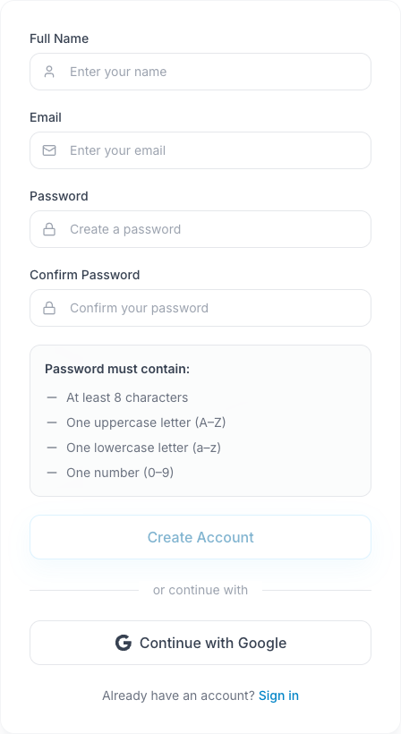

To create an iStudix account, go to [www.istudix.app](https://www.istudix.app/), click **Sign up**, and fill in your name, email, and password. You can also sign up with your Google account.

## Before you start

Use an email inbox you can access and choose a unique password. This documentation is a reference; create your account in [the app](https://www.istudix.app/).

## Steps

<Steps>
  <Step title="Recognize the registration form">
    <Frame>
      
    </Frame>
    The requirements beneath the password fields help you check your password before you submit.
  </Step>
  <Step title="Open iStudix">
    Visit [https://www.istudix.app/](https://www.istudix.app/) in your browser.
  </Step>
  <Step title="Go to Sign up">
    On the sign-in screen, click **Sign up** next to "Don't have an account?".
  </Step>
  <Step title="Enter your details">
    Fill in **Full Name**, **Email**, **Password**, and **Confirm Password**.
  </Step>
  <Step title="Meet the password requirements">
    Your password must contain:

    - At least 8 characters
    - One uppercase letter (A–Z)
    - One lowercase letter (a–z)
    - One number (0–9)

    Each requirement turns green when met, and the **Strength** bar shows how strong your password is.
  </Step>
  <Step title="Create your account">
    Submit the form. The app opens email verification. Check your inbox and follow the verification link before signing in.
  </Step>
</Steps>

<Tip>
  Prefer not to manage a password? Use **Continue with Google** on the sign-in screen instead.
</Tip>

<Note>
  Make sure you type [**www.istudix.app**](http://www.istudix.app) (with `www`) in your browser address bar.
</Note>

## What happens next

After verification, [sign in](/getting-started/sign-in) and follow [your first study session](/quickstart) to create a notebook.

## Need help?

Check your spam folder if the verification email is missing. Use the resend action on the verification screen when available, or see [troubleshooting](/support/troubleshooting). Never share your password or verification link.

## Related articles

- [Sign in to iStudix](/getting-started/sign-in)
- [Can't sign in?](/support/troubleshooting)
- [Get started in 5 minutes](/quickstart)
