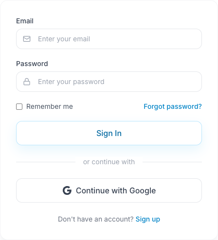

Sign in to iStudix at [www.istudix.app](https://www.istudix.app/) with the email and password you used to sign up, or with your Google account.

## Before you start

Open [the app](https://www.istudix.app/) and use the same sign-in method as when you registered. Keep access to your account email for verification or password recovery.

## Steps

### Sign in with email

<Frame>
  
</Frame>

Enter your account details in the two fields, or choose **Continue with Google** if you registered with Google.

<Steps>
  <Step title="Enter your credentials">
    Type your **Email** and **Password**.
  </Step>
  <Step title="Use shared devices safely">
    Do not rely on **Remember me** to control how long your session lasts. On a shared computer, sign out when you finish and do not save your password in the browser.
  </Step>
  <Step title="Sign in">
    Click **Sign In**. If your email is not verified, the app opens the verification screen. Follow the email link, then sign in again. Otherwise, the app opens your dashboard or the page you were trying to access.
  </Step>
</Steps>

### Sign in with Google

Click **Continue with Google** and choose your Google account.

### Forgot your password?

<Steps>
  <Step title="Request a reset">
    On the sign-in screen, click **Forgot password?** and enter your email.
  </Step>
  <Step title="Check your inbox">
    Open the email from iStudix and follow the link. Check your spam folder if it doesn't arrive.
  </Step>
  <Step title="Choose a new password">
    Set a new password that meets the [password requirements](/getting-started/create-account), then sign in.
  </Step>
</Steps>

## What happens next

Continue from your [dashboard](/getting-started/dashboard) or reopen a notebook. On a shared device, sign out when you finish.

## Need help?

Check the email address and your spam folder if verification or recovery mail is missing. See [troubleshooting](/support/troubleshooting) if you still cannot sign in. Do not send passwords or login codes to support.

## Related articles

- [Create your account](/getting-started/create-account)
- [Can't sign in?](/support/troubleshooting)
- [Manage your account settings](/account/settings)
