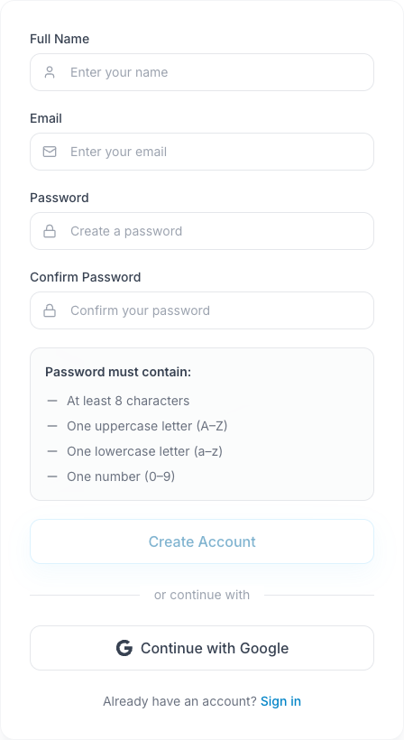

Para criar uma conta no iStudix, aceda a [www.istudix.app](https://www.istudix.app/), clique em **Sign up** e preencha o seu nome, e-mail e palavra-passe. Também pode registar-se com a sua conta Google.

<Steps>
  <Step title="Reconhecer o formulário de registo">
    <Frame>
      
    </Frame>
    A imagem mostra a interface em inglês. Os requisitos por baixo dos campos ajudam a verificar a palavra-passe antes de enviar.
  </Step>
  <Step title="Abrir o iStudix">
    Visite [https://www.istudix.app/](https://www.istudix.app/) no seu navegador.
  </Step>
  <Step title="Ir para Sign up">
    No ecrã de início de sessão, clique em **Sign up** junto a "Don't have an account?".
  </Step>
  <Step title="Introduzir os seus dados">
    Preencha **Full Name**, **Email**, **Password** e **Confirm Password**.
  </Step>
  <Step title="Cumprir os requisitos da palavra-passe">
    A sua palavra-passe deve conter:

    - Pelo menos 8 caracteres
    - Uma letra maiúscula (A-Z)
    - Uma letra minúscula (a-z)
    - Um número (0-9)

    Cada requisito fica verde quando cumprido, e a barra de **Strength** mostra a força da sua palavra-passe.
  </Step>
  <Step title="Criar a sua conta">
    Submeta o formulário. Será levado para o seu [painel de controlo](/pt/getting-started/dashboard).
  </Step>
</Steps>

<Tip>
  Prefere não gerir uma palavra-passe? Utilize **Continue with Google** no ecrã de início de sessão.
</Tip>

<Note>
  Certifique-se de que escreve [**www.istudix.app**](http://www.istudix.app) (com `www`) na barra de endereço do navegador.
</Note>

## Artigos relacionados

- [Iniciar sessão no iStudix](/pt/getting-started/sign-in)
- [Não consegue iniciar sessão?](/pt/support/troubleshooting)
- [Comece a usar em 5 minutos](/pt/quickstart)
