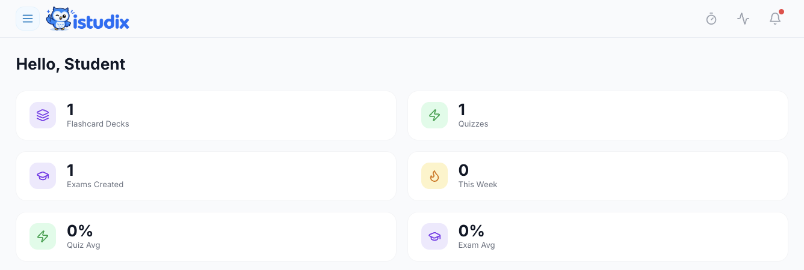

O painel de controlo do iStudix é o seu ecrã inicial após iniciar sessão. A partir daqui, pode aceder a todas as áreas da aplicação: carregar materiais, abrir cadernos, planear sessões e acompanhar o seu progresso.

<Frame caption="Visão geral do painel do exemplo fictício de Biologia. Os contadores e as médias não foram alterados; a saudação foi anonimizada e a atividade privada e o painel de consumo foram excluídos.">
  
</Frame>

## Principais áreas

| Área | O que faz aí |
| --- | --- |
| **Dashboard** | Veja uma visão geral da sua atividade recente e retome o seu trabalho. |
| **Notebooks** | Estude os seus materiais, tome notas e mantenha os temas organizados. |
| **Calendar** | Planeie e agende sessões de estudo. |
| **Account Settings** | Abra o menu do seu nome ou avatar para atualizar o perfil, as preferências e a subscrição. |

A ação rápida do painel pessoal é **New Notebook**. Abra um caderno para adicionar materiais ou criar cartões de memória, quizzes e exames. Consulte a visão geral do painel para ver resultados recentes e abra o caderno para mais detalhes.

<Tip>
  Perdido? Pode sempre voltar ao painel de controlo clicando no logótipo do iStudix.
</Tip>

## Artigos relacionados

- [Carregue os seus materiais de estudo](/pt/using-istudix/upload-materials)
- [Crie e organize cadernos](/pt/using-istudix/notebooks)
- [Gerir as definições da conta](/pt/account/settings)
