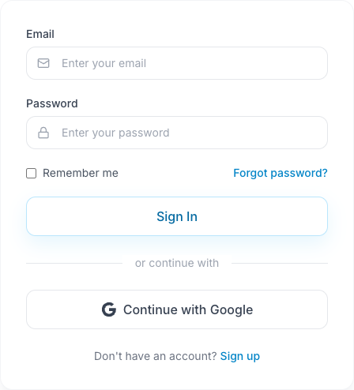

Inicie sessão no iStudix em [www.istudix.app](https://www.istudix.app/) com o email e a palavra-passe que utilizou no registo, ou com a sua conta Google.

## Iniciar sessão com email

<Frame>
  
</Frame>

A imagem mostra a interface em inglês. Introduza os dados da sua conta nos dois campos, ou escolha **Continue with Google** se se registou com Google.

<Steps>
  <Step title="Introduza as suas credenciais">
    Escreva o seu **Email** e a sua **Password**.
  </Step>
  <Step title="Utilizar dispositivos partilhados em segurança">
    Não dependa de **Remember me** para controlar a duração da sessão. Num computador partilhado, termine a sessão quando acabar e não guarde a palavra-passe no navegador.
  </Step>
  <Step title="Iniciar sessão">
    Clique em **Sign In**. Será direcionado para o [painel de controlo](/pt/getting-started/dashboard).
  </Step>
</Steps>

## Iniciar sessão com Google

Clique em **Continue with Google** e escolha a sua conta Google.

## Esqueceu-se da palavra-passe?

<Steps>
  <Step title="Pedir redefinição">
    No ecrã de início de sessão, clique em **Forgot password?** e escreva o seu email.
  </Step>
  <Step title="Verificar a caixa de entrada">
    Abra o email do iStudix e siga a ligação. Verifique a pasta de spam se não receber.
  </Step>
  <Step title="Escolher uma nova palavra-passe">
    Defina uma nova palavra-passe que cumpra os [requisitos de segurança](/pt/getting-started/create-account) e inicie sessão.
  </Step>
</Steps>

## Artigos relacionados

- [Criar a sua conta](/pt/getting-started/create-account)
- [Não consegue iniciar sessão?](/pt/support/troubleshooting)
- [Gerir as definições da conta](/pt/account/settings)
