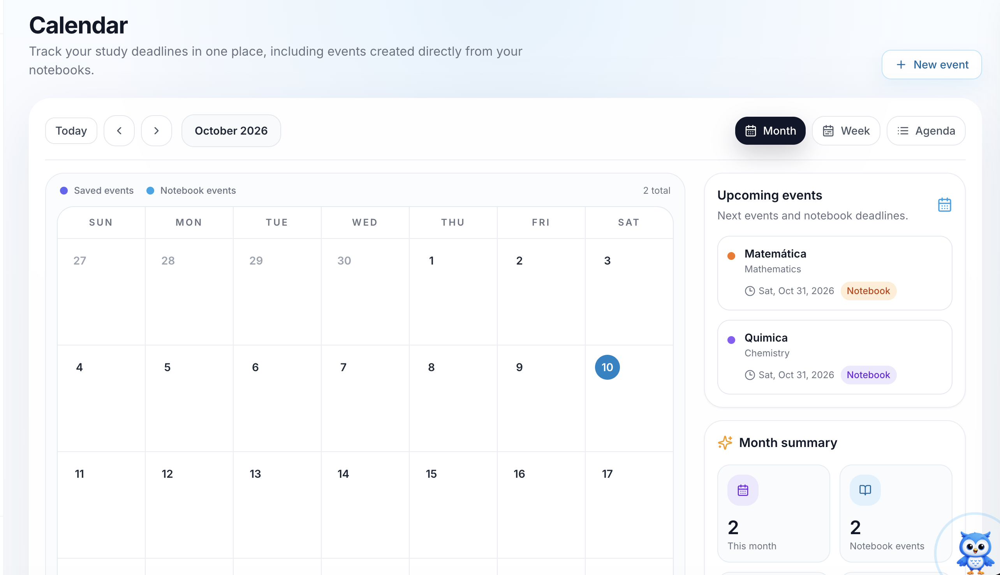
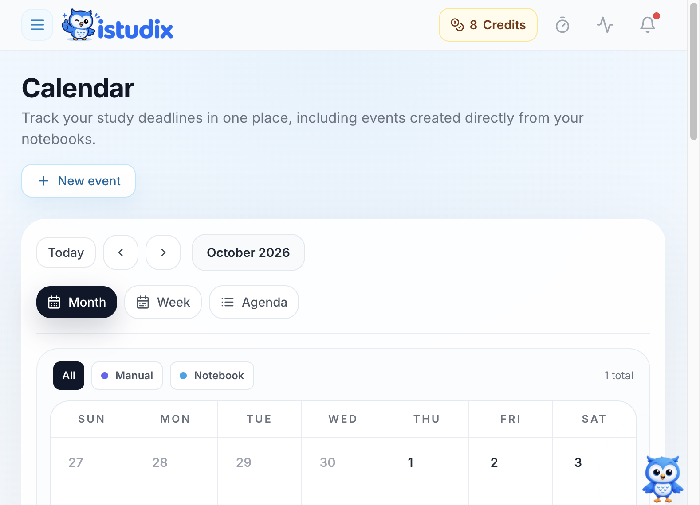

O **Calendar** do iStudix mostra todos os exames, certificações e prazos de estudo futuros num único local. Combina os eventos que adiciona manualmente com os eventos criados diretamente a partir dos seus cadernos, para que saiba sempre o que vem a seguir.

<Frame>
  
</Frame>

## O que vê no Calendário

- **Calendar grid**: o mês atual, com o dia de hoje destacado. Utilize **Today** e os botões de seta para navegar entre datas. O nome do mês é uma etiqueta, não um seletor.
- **Filtros de origem**: escolha **All**, **Manual** ou **Notebook**. A escolha filtra o calendário, os próximos eventos, o histórico e o resumo.
- **Event types**: o calendário mostra dois tipos de eventos:
  - **Saved events**: eventos que adiciona manualmente com **New event**.
  - **Notebook events**: datas de exames adicionadas automaticamente a partir dos seus cadernos.
- **Upcoming events**: até seis eventos com data de hoje ou posterior, excluindo os concluídos, com a disciplina, a data e uma etiqueta de origem.
- **Month summary**: quantos eventos tem este mês e quantos provêm de cadernos.

## Adicionar um exame ao calendário

Os exames são adicionados automaticamente quando criar um caderno. Introduza a data do exame no novo caderno e o iStudix coloca-o no calendário por si.

<Steps>
  <Step title="Criar um novo caderno">
    A partir do seu painel, abra **Notebooks** e crie um novo caderno para a disciplina, por exemplo "Matemática".
  </Step>
  <Step title="Introduzir a data do exame">
    Ao criar o caderno, defina a **exam date**.
  </Step>
  <Step title="Consultar o calendário">
    Abra **Calendar** na barra lateral. O exame aparece na grelha do calendário e em **Upcoming events** com uma etiqueta **Notebook**.
  </Step>
</Steps>

<Tip>
  Crie um caderno assim que souber a data de um exame ou certificação. Depois, planeie sessões de estudo curtas nos dias anteriores para não ter de estudar tudo em cima da hora.
</Tip>

Também pode adicionar outros eventos, como uma sessão de estudo ou um lembrete, com **\+ New event** no canto superior direito do calendário. Estes aparecem como **Saved events**.

## Adicionar, editar ou eliminar um evento manual

1. Selecione **New event**.
2. Introduza um título, a disciplina e a data. Opcionalmente, adicione notas e a antecedência do lembrete.
3. Guarde o evento.

Selecione um evento em **Month**, **Week**, **Agenda**, **Upcoming events** ou no histórico de eventos passados para abrir a mesma janela de detalhes. Esta mostra a disciplina, a data, a origem, o estado e as notas, quando existem.

Num evento manual, escolha **Edit**, altere os campos e guarde. Escolha **Delete** e confirme para o eliminar. Num evento de caderno, escolha **Open notebook** para gerir a data nas definições desse caderno.

## Rever eventos passados

O histórico mostra primeiro os seis eventos passados mais recentes. Expanda-o para ver todos os eventos passados ou volte a recolhê-lo.

Pode marcar um evento manual passado como concluído no histórico ou na janela de detalhes. Utilize **Reopen** para desfazer a conclusão. Os eventos de caderno não têm esta ação. Os eventos manuais concluídos continuam no calendário e no histórico, mas não aparecem em **Upcoming events**.

## Definir lembretes

No formulário do evento, defina quantos dias antes da data pretende receber um lembrete. Deixe o campo vazio se não pretender um. Escolha uma antecedência que caiba antes da data do evento; o formulário avisa se já for demasiado tarde.

Os lembretes utilizam a preferência existente de lembretes de exames em **Account Settings** → **Notifications**. São verificados diariamente e enviados na aplicação e, quando ativadas e disponíveis, por notificações push. Guardar um evento não envia um e-mail de lembrete imediato.

## Ver os seus exames futuros

Consulte o painel **Upcoming events** à direita. Cada cartão mostra:

- O nome do evento ou do caderno (por exemplo, **Matemática**) e a respetiva disciplina (**Mathematics**).
- A data do exame ou prazo.
- Uma etiqueta **Notebook** quando o evento foi criado a partir de um caderno.

## Alternar as vistas do calendário

Utilize os botões no canto superior direito do calendário:

| View | Ideal para |
| --- | --- |
| **Month** | Ver todos os exames e prazos do mês de relance |
| **Week** | Planear o tempo de estudo para os próximos dias |
| **Agenda** | Ver eventos, incluindo os passados, por ordem de data |

No telemóvel, o calendário abre inicialmente em **Agenda**. Pode mudar para **Month** ou **Week** a qualquer momento.

## Perguntas frequentes

<AccordionGroup>
  <Accordion title="Por que é que alguns eventos têm a etiqueta Notebook?">
    Estes eventos provêm da data de exame que definiu ao criar um caderno. Aparecem no calendário automaticamente, por isso não precisa de os adicionar novamente.
  </Accordion>

  <Accordion title="Qual é a diferença entre saved events e notebook events?">
    Os saved events são os que adiciona com **New event**. Os notebook events provêm dos seus cadernos. As cores da legenda no calendário ajudam a distinguir os dois tipos.
  </Accordion>

  <Accordion title="Como volto ao mês atual?">
    Clique em **Today** no canto superior esquerdo do calendário.
  </Accordion>
</AccordionGroup>

## Controlos do calendário

<Frame>
  
</Frame>

A imagem mostra a interface em inglês. Escolha **Month**, **Week** ou **Agenda** para mudar de vista. Use **All**, **Manual** ou **Notebook** para filtrar os eventos, ou selecione **New event** para adicionar uma data.

## Artigos relacionados

- [Criar e organizar cadernos](/pt/using-istudix/notebooks)
- [Preparar com quizzes e exames](/pt/using-istudix/quizzes-and-exams)
- [Acompanhar o seu progresso de aprendizagem](/pt/using-istudix/progress)
