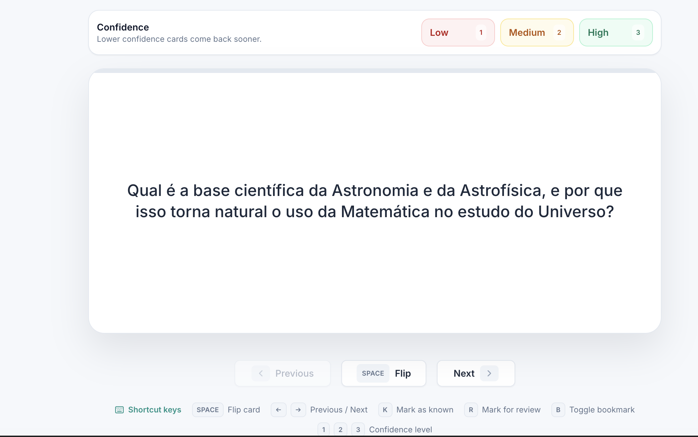

O iStudix gera cartões de memória a partir dos materiais que escolher. À medida que estuda, avalie a sua confiança em cada cartão para ajudar a dar prioridade à revisão durante a sessão.

<Frame>
  
</Frame>

## Criar cartões de memória

<Steps>
  <Step title="Abrir o material">
    Abra um [caderno](/pt/using-istudix/notebooks) que contenha o material que deseja estudar. Se ainda não o adicionou, [carregue-o](/pt/using-istudix/upload-materials) primeiro.
  </Step>
  <Step title="Configurar o conjunto">
    Abra **Flashcards** e escolha a ação para criar um conjunto. Opcionalmente, dê-lhe um nome. Escolha 10, 20 ou 30 cartões, ou uma quantidade personalizada entre 5 e 100.
  </Step>
  <Step title="Escolher materiais e temas">
    Selecione pelo menos um material disponível ou utilize **Select all**. Opcionalmente, selecione temas para focar o conjunto; deixe-os por selecionar para uma cobertura geral dos materiais escolhidos.
  </Step>
  <Step title="Gerar o conjunto">
    Verifique o resumo e a estimativa de créditos e escolha **Generate deck**. Volte à lista de cartões e aguarde o fim do processamento antes de abrir o conjunto.
  </Step>
</Steps>

## Estudar os cartões de memória

<Steps>
  <Step title="Ler a pergunta">
    Tente lembrar-se da resposta antes de virar o cartão.
  </Step>
  <Step title="Virar o cartão">
    Clique em **Flip** (ou prima `Space`) para ver a resposta.
  </Step>
  <Step title="Avaliar a sua confiança">
    Escolha **Low**, **Medium** ou **High**. Isto regista a sua confiança e avança automaticamente para o cartão seguinte, ou termina a sessão quando não há mais nada para rever.
  </Step>
  <Step title="Avançar para o cartão seguinte">
    Utilize **Next** para continuar sem escolher um nível de confiança ou **Previous** para voltar atrás.
  </Step>
</Steps>

A prioridade de revisão combina a confiança com intervalos curtos medidos em minutos, não com um calendário fixo de revisões em dias futuros. Os cartões com baixa confiança têm maior prioridade. Pode continuar a estudar regularmente ao seu ritmo.

## Marcadores e ações do conjunto

Prima `B` para marcar ou desmarcar o cartão atual. Os marcadores são temporários durante o estudo, não uma coleção guardada; são limpos ao reabrir o conjunto ou reiniciar a sessão.

Abra o menu de três pontos durante o estudo:

- **Change order** baralha os cartões e volta ao primeiro, sem limpar as suas avaliações.
- **Reset session** repõe a ordem original do conjunto e recomeça a sessão.
- **Delete deck** abre a confirmação de eliminação. Confirme apenas se pretender remover o conjunto.

<Warning>
  **Reset session** limpa imediatamente as avaliações locais de conhecido/rever, os níveis de confiança, os tempos de revisão e os marcadores. Não elimina o conjunto nem apaga o histórico de estudo anteriormente guardado.
</Warning>

## Atalhos de teclado

| Tecla | Ação |
| --- | --- |
| `Space` | Virar cartão |
| `←` / `→` | Cartão anterior / seguinte |
| `K` | Marcar como conhecido |
| `R` | Marcar para revisão |
| `B` | Alternar marcador |
| `1` / `2` / `3` | Nível de confiança: Low / Medium / High |

<Tip>
  Revise os cartões de memória um pouco todos os dias. Revisões curtas e frequentes ajudam a lembrar-se mais do que uma sessão longa.
</Tip>

## Artigos relacionados

- [Praticar com questionários e exames](/pt/using-istudix/quizzes-and-exams)
- [Colocar perguntas ao AI Tutor sobre o seu caderno](/pt/using-istudix/notebooks)
- [Acompanhar o seu progresso de aprendizagem](/pt/using-istudix/progress)
