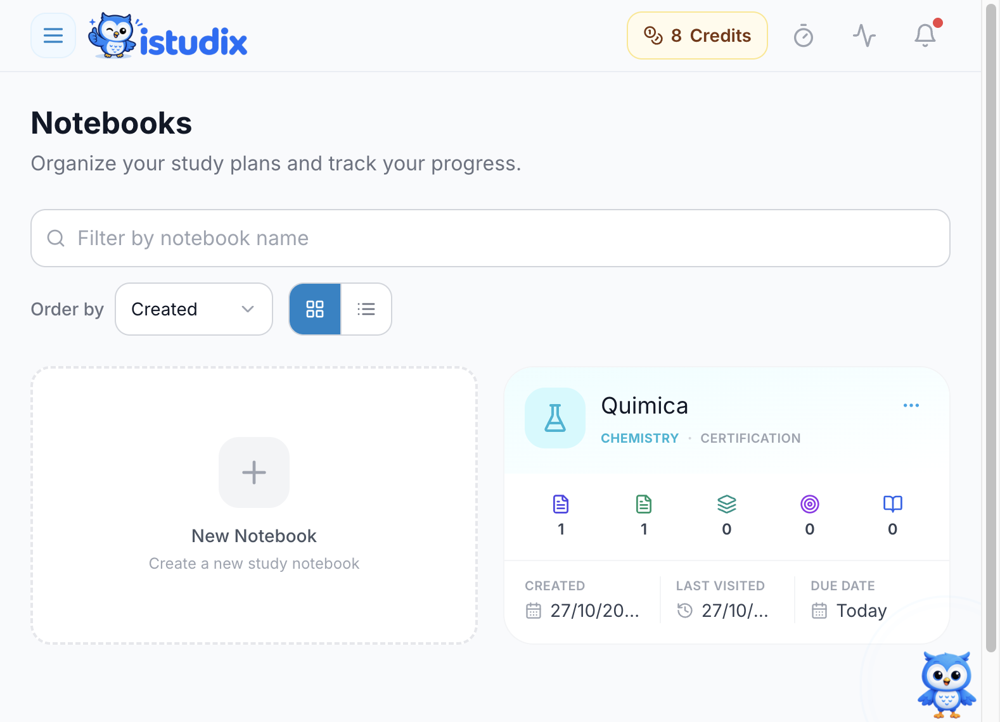
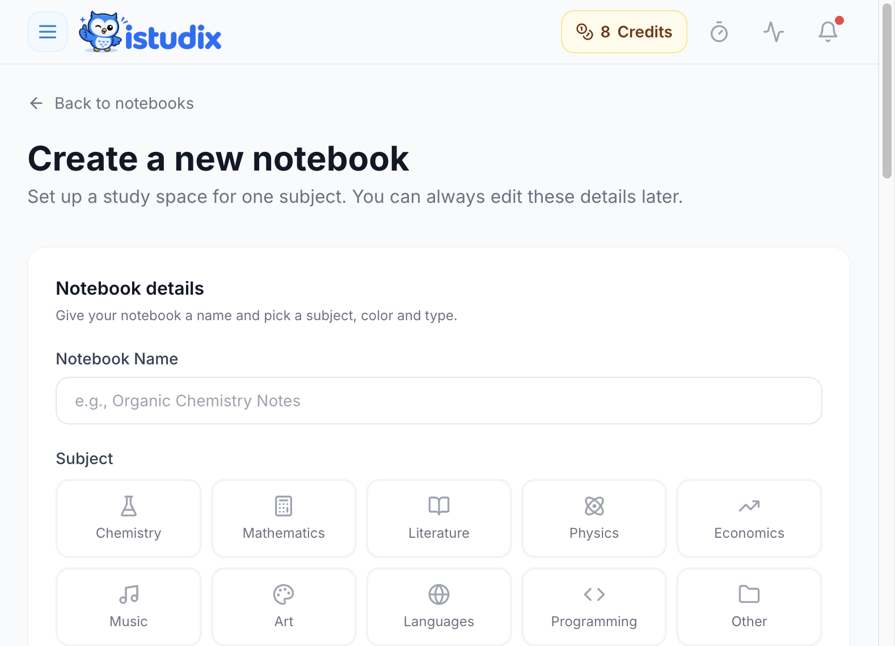
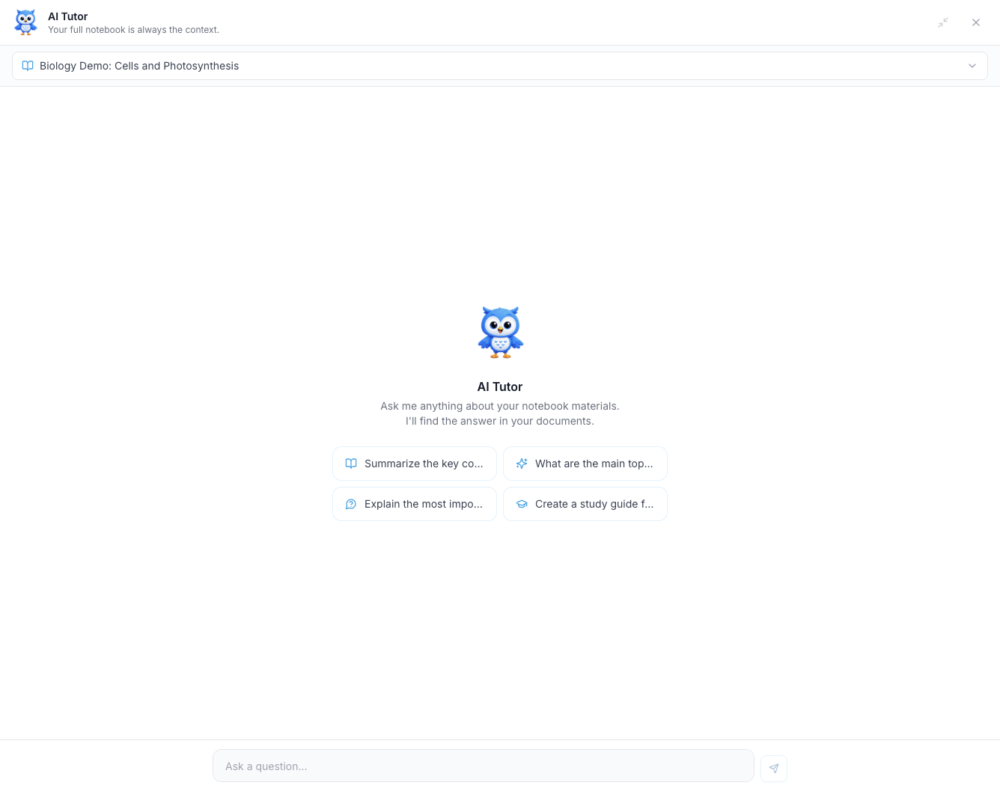

Os cadernos são o local onde estuda no iStudix. Crie um caderno para cada disciplina ou curso, adicione os materiais que carregou e utilize o assistente de IA para colocar perguntas, obter explicações e rever os pontos-chave.

## Antes de começar

Inicie sessão [na aplicação](https://www.istudix.app/) e escolha a disciplina e o nome do caderno. Consulte o [plano atual](/pt/account/plans-and-billing) se não conseguir criar outro caderno. Estas páginas explicam o processo; as ações nos cadernos realizam-se na aplicação.

## Passos

### Criar um caderno

<Frame>
  
</Frame>

A imagem mostra a interface em inglês. Use **New Notebook** para criar um espaço de estudo. A pesquisa e a ordenação ajudam a encontrar os cadernos existentes.

<Frame>
  
</Frame>

Dê um nome reconhecível ao caderno e escolha a disciplina. Continue pelo formulário para consultar as restantes opções antes de guardar.

<Steps>
  <Step title="Abrir Cadernos">
    A partir do seu painel de controlo, clique em **Notebooks**.
  </Step>
  <Step title="Criar um novo caderno">
    Clique para criar um novo caderno e dê-lhe um nome claro, como "Biologia 101" ou "Preparação para o exame".
  </Step>
  <Step title="Definir a data do exame">
    Introduza a data do seu exame. O iStudix adiciona-a automaticamente ao seu [Calendário](/pt/using-istudix/calendar), para que apareça em **Upcoming events**.
  </Step>
  <Step title="Adicionar materiais">
    Adicione ao caderno os materiais que [carregou](/pt/using-istudix/upload-materials).
  </Step>
</Steps>

### Estudar com o AI Tutor

O **AI Tutor** utiliza o caderno atualmente selecionado como contexto para as suas perguntas. Ao abrir um caderno, este fica selecionado no painel do Tutor; confirme o caderno indicado no topo antes de enviar uma pergunta, sobretudo depois de mudar de caderno.

<Warning>
  As respostas da IA podem estar incompletas ou erradas. Verifique explicações importantes, factos e fontes citadas nos materiais originais. O contexto do caderno não garante que todas as respostas sejam sustentadas pelos seus documentos.
</Warning>

<Frame>
  
</Frame>

<Steps>
  <Step title="Abrir o AI Tutor">
    Abra o painel do **AI Tutor**. Clique no ícone de expandir para o tornar maior.
  </Step>
  <Step title="Escolher um caderno">
    Utilize o menu suspenso na parte superior para selecionar o caderno sobre o qual deseja perguntar.
  </Step>
  <Step title="Colocar uma pergunta">
    Escreva em **Ask a question...** e envie, ou clique numa sugestão, como resumir os pontos-chave ou criar um guia de estudo.
  </Step>
</Steps>

Exemplos de perguntas:

- "Resuma as ideias principais deste capítulo."
- "Explique este conceito de forma mais simples."
- "Crie um guia de estudo para este caderno."

<Tip>
  Mantenha um caderno por disciplina. O assistente dá respostas mais focadas quando um caderno contém materiais relacionados.
</Tip>

## O que acontece a seguir

O caderno guardado aparece em **Notebooks**. Adicione materiais e aguarde que estejam prontos antes de gerar [flashcards](/pt/using-istudix/flashcards) ou [quizzes](/pt/using-istudix/quizzes-and-exams). As perguntas ao Tutor e a geração por IA podem utilizar créditos; consulte o saldo e a estimativa, se apresentada, antes de enviar.

## Precisa de ajuda?

Se um material estiver em processamento, em pausa ou tiver falhado, consulte a [resolução de problemas](/pt/support/troubleshooting). Se o Tutor der uma resposta inesperada, confirme o caderno selecionado e compare a resposta com o material original. [Contacte o suporte](/pt/support/contact) se o problema persistir.

## Artigos relacionados

- [Carregar os seus materiais de estudo](/pt/using-istudix/upload-materials)
- [Planear sessões de estudo com o calendário](/pt/using-istudix/calendar)
- [Acompanhar o seu progresso de aprendizagem](/pt/using-istudix/progress)
