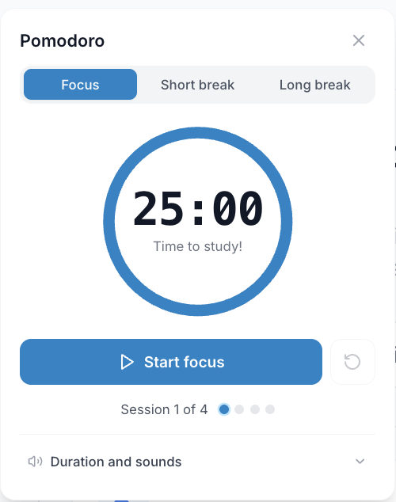
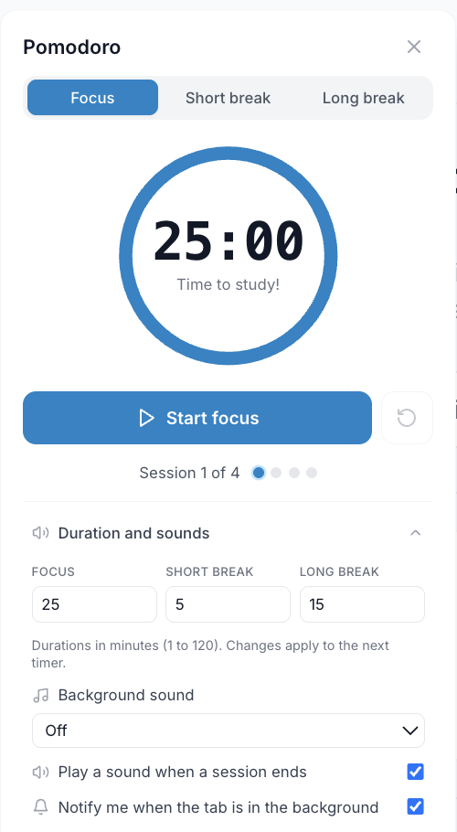

O temporizador **Pomodoro** do iStudix ajuda-o a estudar em sessões curtas e focadas, separadas por pausas. Baseia-se na Técnica Pomodoro, um método de gestão do tempo muito popular que torna os dias de estudo longos mais fáceis de gerir e o ajuda a manter a concentração.

## Antes de começar

Inicie sessão na aplicação e escolha uma tarefa, como rever um conjunto pronto. O temporizador não prepara materiais nem gera ferramentas de estudo por si. Reserve tempo para uma pausa após a sessão.

## Passos

### O que é a Técnica Pomodoro?

A Técnica Pomodoro divide o tempo de estudo em intervalos chamados **pomodoros**:

| Passo | Duração | O que fazer |
| --- | --- | --- |
| **Sessão de foco** | 25 minutos | Estudar um tema sem distrações |
| **Pausa curta** | 5 minutos | Levantar-se, alongar, beber água |
| **Pausa longa** | 15 a 30 minutos | Descansar a sério após cada 4 sessões de foco |

Trabalhar em períodos curtos mantém a mente fresca, facilita começar a estudar e dá-lhe uma noção clara do que já fez.

### Iniciar uma sessão Pomodoro

<Frame>
  
</Frame>

A imagem mostra a interface em inglês. Escolha o modo e selecione **Start focus** para iniciar uma sessão de foco. O contador ajuda a acompanhar as sessões antes de uma pausa mais longa.

<Info>
  O temporizador Pomodoro não está na barra lateral. Abra-o com o ícone do relógio no canto superior direito de qualquer página, depois de iniciar sessão.
</Info>

<Steps>
  <Step title="Abrir o Pomodoro">
    Inicie sessão no [iStudix](https://www.istudix.app/) e clique no ícone do relógio no canto superior direito da página. O temporizador Pomodoro abre.
  </Step>
  <Step title="Escolher o que estudar">
    Escolha um tema ou tarefa para a sessão, por exemplo rever um caderno ou praticar [cartões de memória](/pt/using-istudix/flashcards).
  </Step>
  <Step title="Iniciar o temporizador">
    Inicie o temporizador e concentre-se apenas nessa tarefa até a sessão terminar.
  </Step>
  <Step title="Fazer uma pausa">
    Quando o temporizador terminar, faça uma pausa curta. Após quatro sessões de foco, faça uma pausa mais longa.
  </Step>
</Steps>

<Tip>
  Afaste o telemóvel e feche os separadores que não precisa antes de começar. Um pomodoro funciona melhor quando nada o interrompe.
</Tip>

### Ajustar durações e sons

Abra **Duration and sounds** na parte inferior do temporizador.

<Frame>
  
</Frame>

A imagem mostra a interface em inglês. Defina as durações de foco, pausa curta e pausa longa entre 1 e 120 minutos. As alterações de duração aplicam-se ao próximo temporizador. Escolha um som de fundo ou **Off** e use as caixas de seleção para controlar o som no fim da sessão e as notificações em segundo plano. O navegador pode pedir autorização para as notificações.

## Dicas para estudar com o Pomodoro

- **Uma tarefa por sessão**: decida o que vai estudar antes de iniciar o temporizador.
- **Respeite as pausas**: as pausas ajudam a memorizar o que estudou, por isso não as salte.
- **Combine com outras funcionalidades**: use uma sessão para rever um [caderno](/pt/using-istudix/notebooks), praticar [cartões de memória](/pt/using-istudix/flashcards) ou fazer um [quiz](/pt/using-istudix/quizzes-and-exams).
- **Planeie com antecedência**: antes de um exame, use o [Calendário](/pt/using-istudix/calendar) para planear quantas sessões precisa por dia.

## O que acontece a seguir

Faça uma pausa e decida se pretende continuar o mesmo tema ou mudar de tarefa. Termine cada quiz ou exame através da respetiva ação de conclusão; chegar ao fim do temporizador não equivale a concluir uma avaliação.

## Precisa de ajuda?

Se não encontrar o temporizador, procure o ícone do relógio no canto superior direito depois de iniciar sessão, não na barra lateral. Se a aplicação não responder, consulte a [resolução de problemas](/pt/support/troubleshooting). Evite atualizar a página durante uma avaliação por terminar sem verificar o estado de gravação.

## Perguntas frequentes

<AccordionGroup>
  <Accordion title="E se for interrompido durante uma sessão?">
    Se a interrupção for curta, tome nota e volte ao trabalho. Se tiver de parar, reinicie a sessão quando estiver pronto, para que cada pomodoro seja totalmente focado.
  </Accordion>

  <Accordion title="25 minutos é a duração certa para todos?">
    25 minutos é a duração clássica e um bom ponto de partida. Alguns estudantes preferem sessões mais longas para trabalho profundo. Experimente e ajuste ao que lhe funciona melhor.
  </Accordion>

  <Accordion title="Quantos pomodoros devo fazer por dia?">
    Depende do seu horário e da proximidade do exame. Muitos estudantes fazem entre 4 e 8 sessões por dia.
  </Accordion>
</AccordionGroup>

## Artigos relacionados

- [Planear os exames com o Calendário](/pt/using-istudix/calendar)
- [Estudar com cartões de memória](/pt/using-istudix/flashcards)
- [Acompanhar o seu progresso](/pt/using-istudix/progress)
