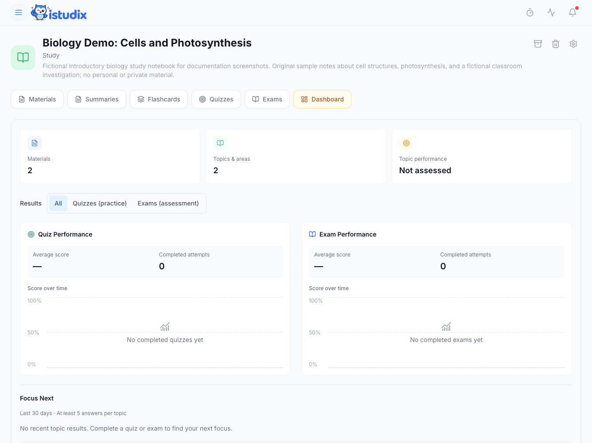

Consulte os resultados recentes no painel principal e abra o separador **Dashboard** de um caderno para ver o desempenho em quizzes e exames, o histórico de tentativas e os resultados por tema. Não existe um item **Progress** separado na barra lateral principal.

<Frame caption="Caderno fictício de Biologia antes de concluir uma avaliação: não foram adicionadas pontuações nem tentativas concluídas. O recorte mostra a visão geral dos resultados e Focus Next.">
  
</Frame>

## Antes de começar

Conclua um quiz ou exame na aplicação para fornecer evidências de avaliação. Carregar materiais ou gerar questões não demonstra, por si só, o que sabe. Utilize o caderno em que realizou a tentativa.

## Passos

### Ver o seu progresso

<Steps>
  <Step title="Abrir os resultados do caderno">
    Abra **Notebooks**, selecione um caderno e escolha o separador **Dashboard**.
  </Step>
  <Step title="Rever a sua atividade">
    Consulte as médias e o número de tentativas de quizzes e exames. Selecione um dia no gráfico de desempenho para ver as tentativas e depois uma tentativa para consultar os resultados.
  </Step>
  <Step title="Planear o que vem a seguir">
    Concentre as suas próximas [sessões de estudo](/pt/using-istudix/calendar) nos temas em que está mais fraco.
  </Step>
</Steps>

<Note>
  Os resultados dependem das tentativas de estudo registadas. Um tema sem evidências de avaliação não é necessariamente um tema fraco. Utilize os resultados apresentados para decidir o que praticar, não como garantia de preparação para o exame.
</Note>

## O que acontece a seguir

Escolha um tema para rever a partir dos resultados registados, pratique e compare a próxima tentativa concluída. Uma média descreve essas tentativas, não todo o seu conhecimento da disciplina. Um tema sem resultados pode precisar de uma primeira avaliação, em vez de estudo de recuperação.

## Precisa de ajuda?

Se faltarem resultados, verifique o caderno, a data selecionada no gráfico e se terminou a tentativa. Se uma tentativa concluída continuar sem aparecer, [contacte o suporte](/pt/support/contact) com o caderno, o nome da avaliação e a hora aproximada de conclusão. Não gere avaliações repetidamente para corrigir um resultado em falta.

## Artigos relacionados

- [Planear sessões de estudo com o calendário](/pt/using-istudix/calendar)
- [Criar e organizar cadernos](/pt/using-istudix/notebooks)
- [Perguntas frequentes](/pt/support/faq)
