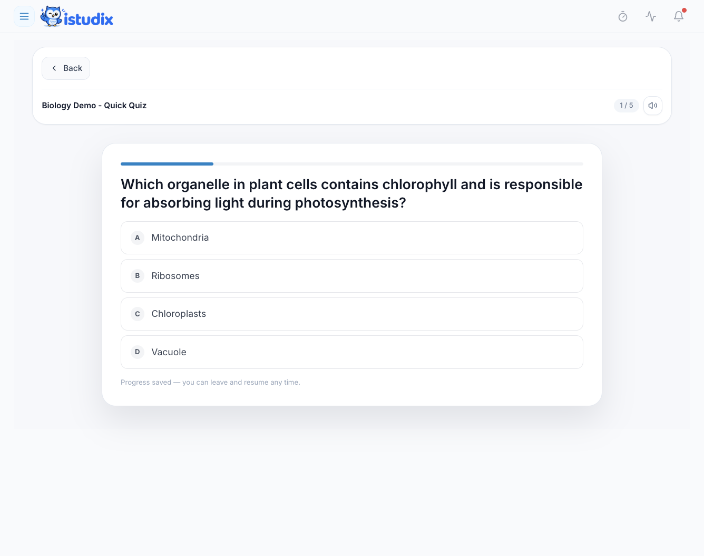
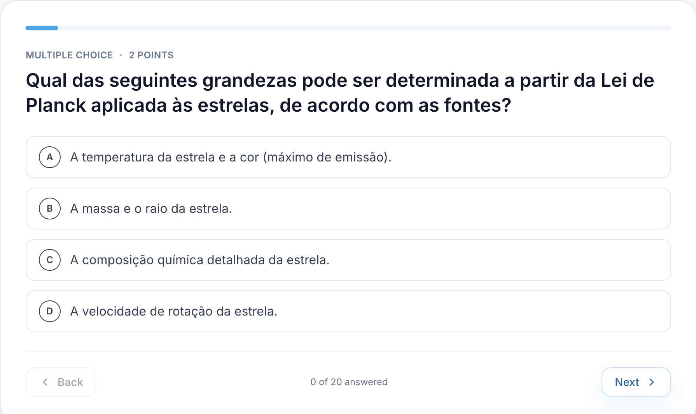

O iStudix cria quizzes e exames de prática a partir dos seus materiais de estudo. Utilize os quizzes para verificações rápidas de escolha múltipla enquanto aprende, e os exames para um teste mais longo e pontuado antes da prova real.

## Criar um quiz ou exame

<Steps>
  <Step title="Abrir o seu material">
    Abra um [caderno](/pt/using-istudix/notebooks) com os materiais sobre os quais pretende ser testado.
  </Step>
  <Step title="Escolher Quiz ou Exame">
    Selecione **Quiz** para uma verificação breve, ou **Exam** para um teste de prática mais longo.
  </Step>
  <Step title="Gerar">
    Deixe o iStudix gerar questões com base no seu conteúdo.
  </Step>
</Steps>

## Fazer um quiz

Cada questão do quiz apresenta quatro opções, de **A** a **D**. Clique na resposta que considera correta. A barra no topo mostra o seu progresso no quiz.

<Frame>
  
</Frame>

## Fazer um exame

As questões dos exames mostram o tipo e o valor em pontos acima da questão, por exemplo **Multiple choice · 2 points**. O contador na parte inferior mostra quantas questões respondeu, como "0 of 20 answered".

<Frame>
  
</Frame>

<Steps>
  <Step title="Responder à questão">
    Numa questão de escolha, selecione uma das opções apresentadas. Numa questão de resposta curta ou aberta, escreva a resposta no campo indicado. Siga o tipo de questão apresentado acima do enunciado.
  </Step>
  <Step title="Navegar entre as questões">
    Clique em **Next** para continuar, ou em **Back** para rever uma questão anterior.
  </Step>
  <Step title="Concluir e rever">
    Depois de responder a todas as questões, submeta o exame e consulte a sua pontuação e as questões que errou.
  </Step>
  <Step title="Estudar os pontos fracos">
    Volte ao material relacionado ou aos [flashcards](/pt/using-istudix/flashcards) dos temas em que errou.
  </Step>
</Steps>

<Tip>
  Antes de um exame real, agende um exame de prática no seu [calendário](/pt/using-istudix/calendar) alguns dias antes, para ter tempo de rever os seus erros.
</Tip>

## Artigos relacionados

- [Criar e estudar flashcards](/pt/using-istudix/flashcards)
- [Acompanhar o seu progresso de aprendizagem](/pt/using-istudix/progress)
- [Criar e organizar cadernos](/pt/using-istudix/notebooks)

O iStudix cria quizzes e exames de prática a partir dos seus materiais de estudo. Utilize os quizzes para verificações rápidas de escolha múltipla enquanto aprende, e os exames para um teste mais longo e pontuado antes da prova real.

## Criar um quiz ou exame

<Steps>
  <Step title="Abrir o seu material">
    Abra um [caderno](/pt/using-istudix/notebooks) com os materiais sobre os quais pretende ser testado.
  </Step>
  <Step title="Escolher Quiz ou Exame">
    Selecione **Quiz** para uma verificação breve, ou **Exam** para um teste de prática mais longo.
  </Step>
  <Step title="Gerar">
    Deixe o iStudix gerar questões com base no seu conteúdo.
  </Step>
</Steps>

## Fazer um quiz

Cada questão do quiz apresenta quatro opções, de **A** a **D**. Clique na resposta que considera correta. A barra no topo mostra o seu progresso no quiz.

<Frame>
  
</Frame>

## Fazer um exame

As questões dos exames mostram o tipo e o valor em pontos acima da questão, por exemplo **Multiple choice · 2 points**. O contador na parte inferior mostra quantas questões respondeu, como "0 of 20 answered".

<Frame>
  
</Frame>

<Steps>
  <Step title="Responder à questão">
    Numa questão de escolha, selecione uma das opções apresentadas. Numa questão de resposta curta ou aberta, escreva a resposta no campo indicado. Siga o tipo de questão apresentado acima do enunciado.
  </Step>
  <Step title="Navegar entre as questões">
    Clique em **Next** para continuar, ou em **Back** para rever uma questão anterior.
  </Step>
  <Step title="Concluir e rever">
    Depois de responder a todas as questões, submeta o exame e consulte a sua pontuação e as questões que errou.
  </Step>
  <Step title="Estudar os pontos fracos">
    Volte ao material relacionado ou aos [flashcards](/pt/using-istudix/flashcards) dos temas em que errou.
  </Step>
</Steps>

<Tip>
  Antes de um exame real, agende um exame de prática no seu [calendário](/pt/using-istudix/calendar) alguns dias antes, para ter tempo de rever os seus erros.
</Tip>

## Artigos relacionados

- [Criar e estudar flashcards](/pt/using-istudix/flashcards)
- [Acompanhar o seu progresso de aprendizagem](/pt/using-istudix/progress)
- [Criar e organizar cadernos](/pt/using-istudix/notebooks)
