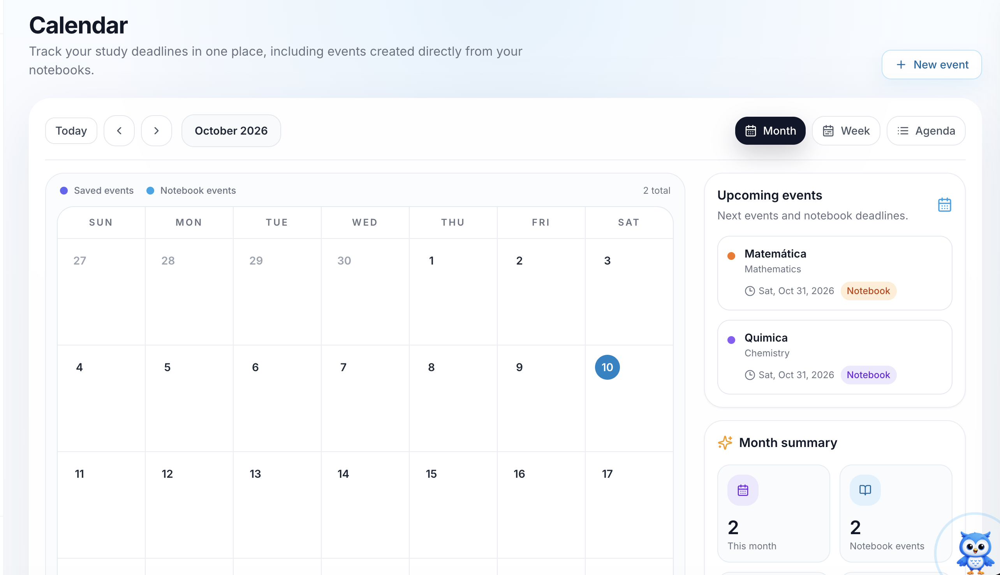

The iStudix **Calendar** shows every upcoming exam, certification, and study deadline in one place. It combines events you add yourself with events created directly from your notebooks, so you always know what is coming next.

<Frame>
  
</Frame>

## What you see on the Calendar

- **Calendar grid**: the current month, with today highlighted. Use **Today**, the arrow buttons, and the month selector to move between dates.
- **Event types**: the legend at the top of the grid shows two kinds of events:
  - **Saved events**: events you add yourself with **New event**.
  - **Notebook events**: exam dates added automatically from your notebooks.
- **Upcoming events**: a list of your next events and notebook deadlines, with the subject, date, and a tag showing where the event came from.
- **Month summary**: how many events you have this month and how many come from notebooks.

## Add an exam to the calendar

Exams are added automatically when you create a notebook. Enter the exam date in the new notebook, and iStudix places it on the calendar for you.

<Steps>
  <Step title="Create a new notebook">
    From your dashboard, open **Notebooks** and create a new notebook for the subject, for example "Matemática".
  </Step>
  <Step title="Enter the exam date">
    While creating the notebook, set the **exam date**.
  </Step>
  <Step title="Check the calendar">
    Open **Calendar** from the sidebar. The exam appears on the calendar grid and in **Upcoming events** with a **Notebook** tag.
  </Step>
</Steps>

<Tip>
  Create a notebook as soon as you know an exam or certification date. Then plan short study sessions in the days before so you are not cramming at the last minute.
</Tip>

You can also add other events, such as a study session or a reminder, with **\+ New event** in the top-right corner of the calendar. These show up as **Saved events**.

## See your upcoming exams

Check the **Upcoming events** panel on the right. Each card shows:

- The event or notebook name (for example, **Matemática**) and its subject (**Mathematics**).
- The date of the exam or deadline.
- A **Notebook** tag when the event was created from a notebook.

## Switch calendar views

Use the buttons in the top-right of the calendar:

| View | Best for |
| --- | --- |
| **Month** | Seeing all exams and deadlines in the month at a glance |
| **Week** | Planning study time for the next few days |
| **Agenda** | Reading a simple list of upcoming events in date order |

## Frequently asked questions

<AccordionGroup>
  <Accordion title="Why are some events tagged Notebook?">
    These events come from the exam date you set when creating a notebook. They show up on the calendar automatically, so you don't need to add them again.
  </Accordion>

  <Accordion title="What is the difference between saved events and notebook events?">
    Saved events are ones you add with **New event**. Notebook events come from your notebooks. The legend colors on the calendar help you tell them apart.
  </Accordion>

  <Accordion title="How do I go back to the current month?">
    Click **Today** at the top-left of the calendar.
  </Accordion>
</AccordionGroup>

## Related articles

- [Create and organize notebooks](/using-istudix/notebooks)
- [Prepare with quizzes and exams](/using-istudix/quizzes-and-exams)
- [Track your learning progress](/using-istudix/progress)
