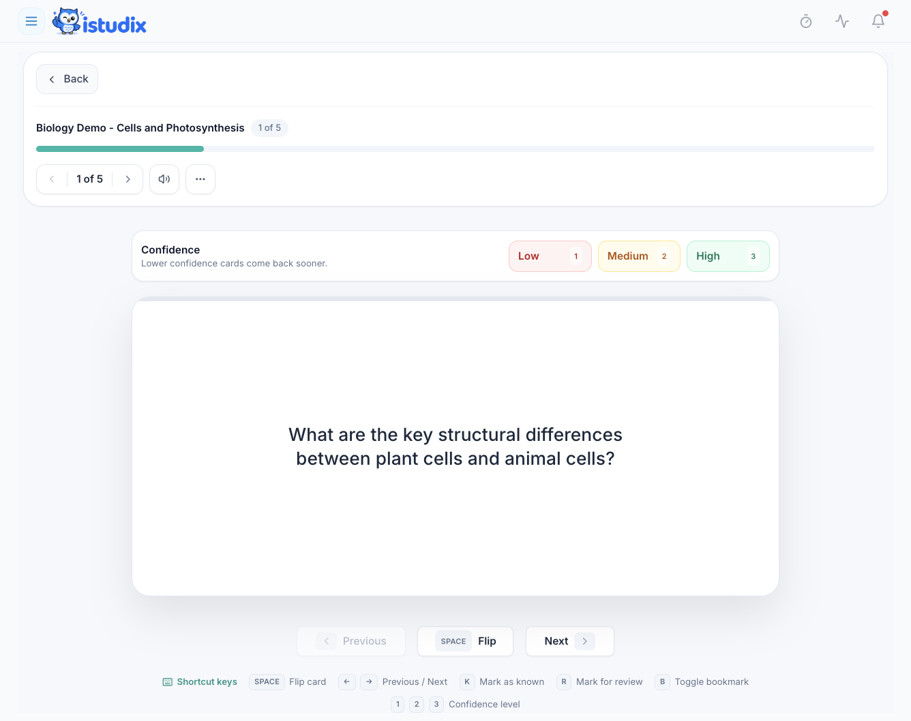

iStudix generates flashcards from the materials you choose. As you study, rate your confidence on each card to help prioritize review within your study session.

<Frame caption="First of five flashcards in the fictional Biology notebook, shown before choosing a confidence level.">
  
</Frame>

## Before you start

Have at least one ready material in your notebook. Open **Flashcards** in the app, check your current plan and available credits, and review the generation estimate. A queued or processing material is not ready for selection yet.

## Steps

### Create flashcards

<Steps>
  <Step title="Open your material">
    Open a [notebook](/using-istudix/notebooks) that contains the material you want to study. If you haven't added it yet, [upload it](/using-istudix/upload-materials) first.
  </Step>
  <Step title="Configure your deck">
    Open **Flashcards** and choose the new-deck action. Optionally name the deck. Choose 10, 20, or 30 cards, or a custom count from 5 to 100.
  </Step>
  <Step title="Choose materials and topics">
    Select at least one available material, or use **Select all**. Optionally select topics to focus the deck; leave topics unselected for general coverage of the selected materials.
  </Step>
  <Step title="Generate the deck">
    Check the summary and credit estimate, then choose **Generate deck**. Return to the flashcards list and wait for processing to finish before opening the deck.
  </Step>
</Steps>

### Study your flashcards

<Steps>
  <Step title="Read the question">
    Try to recall the answer before you flip the card.
  </Step>
  <Step title="Flip the card">
    Click **Flip** (or press `Space`) to see the answer.
  </Step>
  <Step title="Rate your confidence">
    Choose **Low**, **Medium**, or **High**. This records your confidence and automatically moves to the next card, or ends the session when there is nothing else to review.
  </Step>
  <Step title="Move to the next card">
    Use **Next** to continue without choosing confidence, or **Previous** to go back.
  </Step>
</Steps>

Review priority combines confidence and short intervals measured in minutes, not a fixed schedule of reviews across future days. Low-confidence cards receive higher priority. You can still choose to study regularly at your own pace.

## Bookmarks and deck actions

Press `B` to mark or unmark the current card. Bookmarks are temporary study-session markers, not a saved collection; they reset when you reopen the deck or reset the session.

Open the three-dot menu while studying:

- **Change order** shuffles the cards and returns to the first card without clearing your ratings.
- **Reset session** restores the original deck order and starts again.
- **Delete deck** opens the deletion confirmation. Confirm only if you want to remove the deck.

<Warning>
  **Reset session** immediately clears local known/review ratings, confidence choices, review timing, and bookmarks. It does not delete the deck or erase previously saved study history.
</Warning>

## Keyboard shortcuts

| Key | Action |
| --- | --- |
| `Space` | Flip card |
| `←` / `→` | Previous / Next card |
| `K` | Mark as known |
| `R` | Mark for review |
| `B` | Toggle bookmark |
| `1` / `2` / `3` | Confidence level: Low / Medium / High |

<Tip>
Review flashcards a little every day. Short, frequent reviews help you remember more than one long session.
</Tip>

## What happens next

Reopen the ready deck for more practice. Confidence helps prioritize cards during the session; temporary bookmarks do not carry over when you reopen it. Generating another deck is a separate action and may use more credits. Review important answers against the original material.

## Need help?

If a deck is queued or processing, wait rather than submitting generation again. For paused or failed generation, see [troubleshooting](/support/troubleshooting). If a card looks wrong, check the source and [contact support](/support/contact); do not rely on it as a verified answer.

## Related articles

- [Practice with quizzes and exams](/using-istudix/quizzes-and-exams)
- [Ask the AI Tutor about your notebook](/using-istudix/notebooks)
- [Track your learning progress](/using-istudix/progress)
