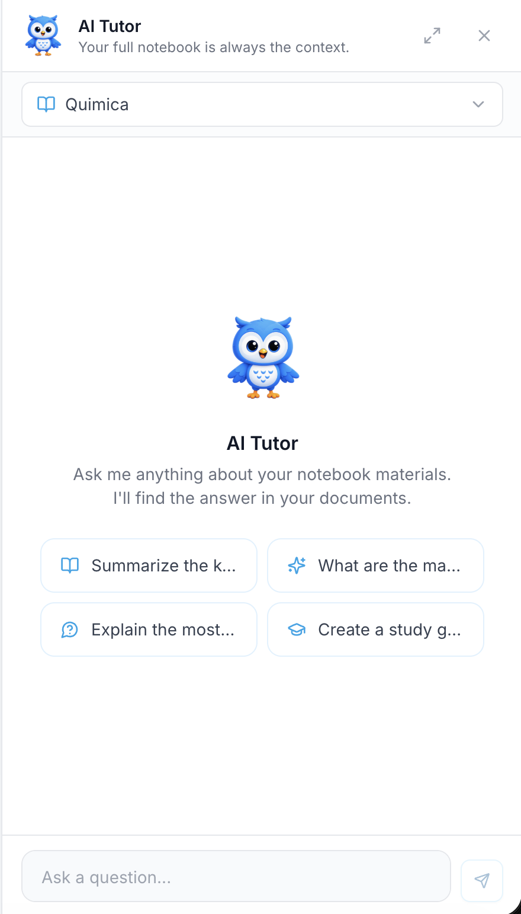

Notebooks are where you study in iStudix. Create a notebook for each subject or course, add your uploaded materials, and use the AI assistant to ask questions, get explanations, and review key points.

## Create a notebook

<Steps>
  <Step title="Open Notebooks">
    From your dashboard, click **Notebooks**.
  </Step>
  <Step title="Create a new notebook">
    Click to create a new notebook and give it a clear name, such as "Biology 101" or "Exam prep".
  </Step>
  <Step title="Set the exam date">
    Enter the date of your exam. iStudix adds it to your [Calendar](/using-istudix/calendar) automatically, so it appears in **Upcoming events**.
  </Step>
  <Step title="Add materials">
    Add materials you've [uploaded](/using-istudix/upload-materials) to the notebook.
  </Step>
</Steps>

## Study with the AI Tutor

The **AI Tutor** answers questions using your notebook's materials. Your full notebook is always the context, so answers come from your own documents.

<Frame>
  
</Frame>

<Steps>
  <Step title="Open the AI Tutor">
    Open the **AI Tutor** panel. Click the expand icon to make it larger.
  </Step>
  <Step title="Choose a notebook">
    Use the dropdown at the top to pick the notebook you want to ask about.
  </Step>
  <Step title="Ask a question">
    Type in **Ask a question...** and send it, or click a suggested prompt such as summarizing key points or creating a study guide.
  </Step>
</Steps>

Example questions:

- "Summarize the main ideas of this chapter."
- "Explain this concept in simpler terms."
- "Create a study guide for this notebook."

<Tip>
  Keep one notebook per subject. The assistant gives more focused answers when a notebook contains related materials.
</Tip>

## Related articles

- [Upload your study materials](/using-istudix/upload-materials)
- [Plan study sessions with the calendar](/using-istudix/calendar)
- [Track your learning progress](/using-istudix/progress)
