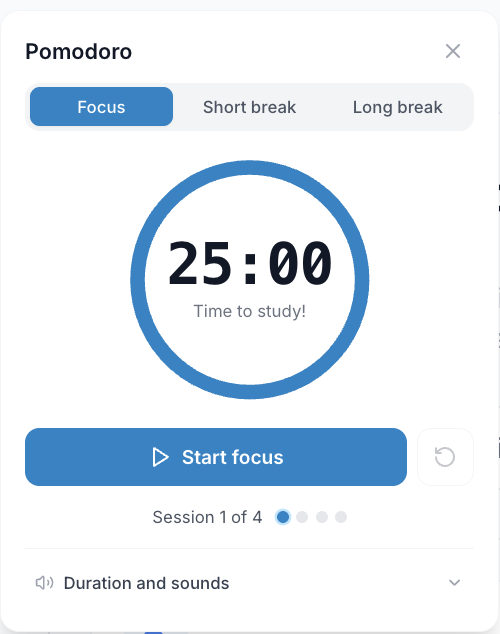
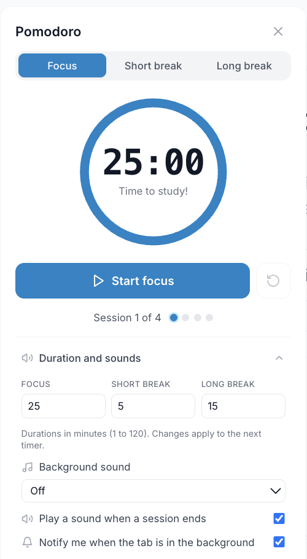

The iStudix **Pomodoro** timer helps you study in short, focused sessions separated by breaks. It is based on the Pomodoro Technique, a popular time management method that makes long study days easier to manage and helps you stay concentrated.

## Before you start

Sign in to the app and choose one task, such as reviewing a ready deck. The timer does not prepare materials or generate study tools for you. Leave time for a break after the session.

## Steps

### What is the Pomodoro Technique?

The Pomodoro Technique splits your study time into intervals called **pomodoros**:

| Step | Duration | What to do |
| --- | --- | --- |
| **Focus session** | 25 minutes | Study one topic with no distractions |
| **Short break** | 5 minutes | Stand up, stretch, drink water |
| **Long break** | 15 to 30 minutes | Rest properly after every 4 focus sessions |

Working in short bursts keeps your mind fresh, makes it easier to start studying, and gives you a clear sense of how much you've done.

### Start a Pomodoro session

<Frame>
  
</Frame>

Choose a timer mode, then select **Start focus** to begin a focus session. The session counter helps you track your focus sessions before a longer break.

<Info>
  The Pomodoro timer is not in the sidebar. Open it with the clock icon in the top-right corner of any page after you sign in.
</Info>

<Steps>
  <Step title="Open Pomodoro">
    Sign in to [iStudix](https://www.istudix.app/) and click the clock icon in the top-right corner of the page. The Pomodoro timer opens.
  </Step>
  <Step title="Choose what to study">
    Pick one topic or task for the session, for example reviewing a notebook or practicing [flashcards](/using-istudix/flashcards).
  </Step>
  <Step title="Start the timer">
    Start the timer and focus only on that task until the session ends.
  </Step>
  <Step title="Take a break">
    When the timer ends, take a short break. After four focus sessions, take a longer break.
  </Step>
</Steps>

<Tip>
  Put your phone out of reach and close unrelated tabs before you start. A pomodoro works best when nothing interrupts it.
</Tip>

### Adjust durations and sounds

Open **Duration and sounds** at the bottom of the timer.

<Frame>
  
</Frame>

Set focus, short-break, and long-break durations from 1 to 120 minutes. Duration changes apply to the next timer. Choose a background sound or **Off**, and use the checkboxes to control the end-of-session sound and background notifications. Browser permissions may be required for notifications.

## Tips for studying with Pomodoro

- **One task per session**: decide what you'll study before starting the timer.
- **Respect the breaks**: breaks help you remember what you studied, so don't skip them.
- **Combine with other features**: use a session to review a [notebook](/using-istudix/notebooks), practice [flashcards](/using-istudix/flashcards), or take a [quiz](/using-istudix/quizzes-and-exams).
- **Plan ahead**: before an exam, use the [Calendar](/using-istudix/calendar) to plan how many sessions you need each day.

## What happens next

Take a break, then choose whether to continue the same topic or switch tasks. Complete any quiz or exam using its own completion action; reaching the end of the timer is not the same as finishing an assessment.

## Need help?

If you cannot find the timer, check the top-right clock icon after signing in, not the sidebar. If the app does not respond, see [troubleshooting](/support/troubleshooting). Avoid refreshing during an unfinished assessment without checking its save status.

## Frequently asked questions

<AccordionGroup>
  <Accordion title="What if I get interrupted during a session?">
    If the interruption is short, note it down and get back to work. If you have to stop, restart the session when you're ready, so each pomodoro stays fully focused.
  </Accordion>

  <Accordion title="Is 25 minutes the right length for everyone?">
    25 minutes is the classic length and a good place to start. Some students prefer longer sessions for deep work. Try it and adjust to what suits you.
  </Accordion>

  <Accordion title="How many pomodoros should I do per day?">
    It depends on your schedule and how close your exam is. Many students aim for 4 to 8 sessions per day.
  </Accordion>
</AccordionGroup>

## Related articles

- [Plan your exams with the Calendar](/using-istudix/calendar)
- [Study with flashcards](/using-istudix/flashcards)
- [Track your learning progress](/using-istudix/progress)
