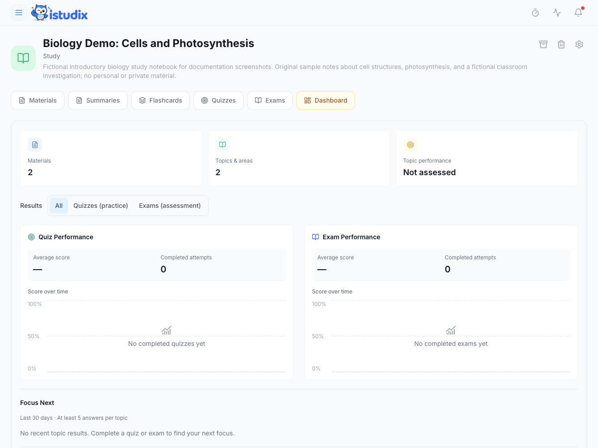

Review your recent results on the main dashboard, then open a notebook's **Dashboard** tab for quiz and exam performance, attempt history, and topic results. There is no separate **Progress** item in the main sidebar.

<Frame caption="Fictional Biology notebook before any completed assessment: no scores or completed attempts have been added. This crop shows the results overview and Focus Next.">
  
</Frame>

## Before you start

Finish a quiz or exam in the app to provide assessment evidence. Simply uploading materials or generating questions does not demonstrate what you know. Use the notebook where you completed the attempt.

## Steps

### View your progress

<Steps>
  <Step title="Open notebook results">
    Open **Notebooks**, select a notebook, and choose its **Dashboard** tab.
  </Step>
  <Step title="Review your activity">
    Review quiz and exam averages and attempt counts. Select a day in a performance chart to see its attempts, then select an attempt to inspect its results.
  </Step>
  <Step title="Plan what's next">
    Focus your next [study sessions](/using-istudix/calendar) on the topics where you're weakest.
  </Step>
</Steps>

<Note>
  Results depend on recorded study attempts. A topic without assessment evidence is not necessarily a weak topic. Use the displayed results to decide what to practice, not as a guarantee of exam readiness.
</Note>

## What happens next

Choose one topic to review from the recorded results, practise it, and compare your next completed attempt. An average describes those attempts, not your whole subject knowledge. A topic with no results may need its first assessment rather than remedial study.

## Need help?

If results are missing, check the notebook, selected chart date, and whether the attempt was finished. If a completed attempt still does not appear, [contact support](/support/contact) with the notebook, assessment name, and approximate completion time. Do not repeatedly generate new assessments to fix a missing result.

## Related articles

- [Plan study sessions with the calendar](/using-istudix/calendar)
- [Create and organize notebooks](/using-istudix/notebooks)
- [Frequently asked questions](/support/faq)
