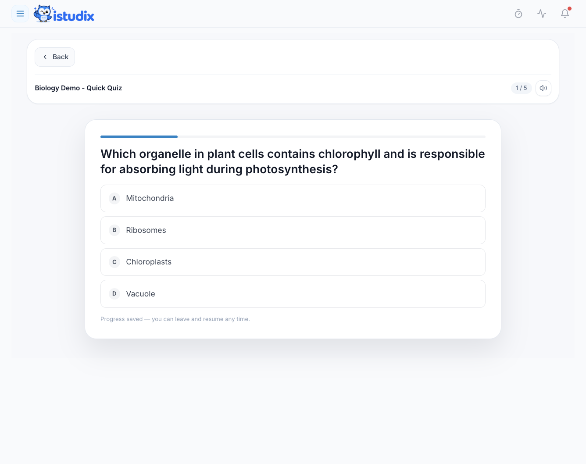
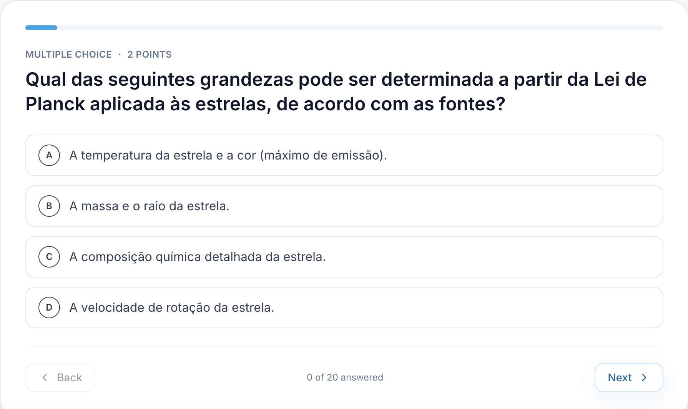

iStudix creates quizzes and practice exams from your study materials. Use quizzes for quick multiple-choice checks while you learn, and exams for a longer, scored test before the real thing.

## Create a quiz or exam

<Steps>
  <Step title="Open your material">
    Open a [notebook](/using-istudix/notebooks) with the materials you want to be tested on.
  </Step>
  <Step title="Choose Quiz or Exam">
    Select **Quiz** for a short check, or **Exam** for a longer practice test.
  </Step>
  <Step title="Generate">
    Let iStudix generate questions based on your content.
  </Step>
</Steps>

## Take a quiz

Each quiz question has four options, **A** to **D**. Click the answer you think is correct. The bar at the top shows how far through the quiz you are.

<Frame>
  
</Frame>

## Take an exam

Exam questions show their type and point value above the question, for example **Multiple choice · 2 points**. The counter at the bottom shows how many questions you've answered, such as "0 of 20 answered".

<Frame>
  
</Frame>

<Steps>
  <Step title="Answer the question">
    For a choice question, select one of the displayed options. For a short or open-answer question, type your response in the answer field. Follow the question type shown above the prompt.
  </Step>
  <Step title="Move between questions">
    Click **Next** to continue, or **Back** to review a previous question.
  </Step>
  <Step title="Finish and review">
    When you've answered every question, submit the exam and review your score and the questions you missed.
  </Step>
  <Step title="Study your weak spots">
    Go back to the related material or [flashcards](/using-istudix/flashcards) for the topics you missed.
  </Step>
</Steps>

<Tip>
Before a real exam, schedule a practice exam in your [calendar](/using-istudix/calendar) a few days ahead so you have time to review your mistakes.
</Tip>

## Related articles

- [Create and study flashcards](/using-istudix/flashcards)
- [Track your learning progress](/using-istudix/progress)
- [Create and organize notebooks](/using-istudix/notebooks)
